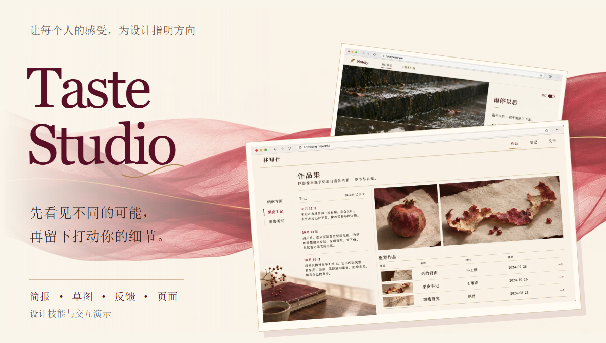
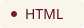
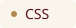
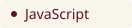
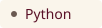
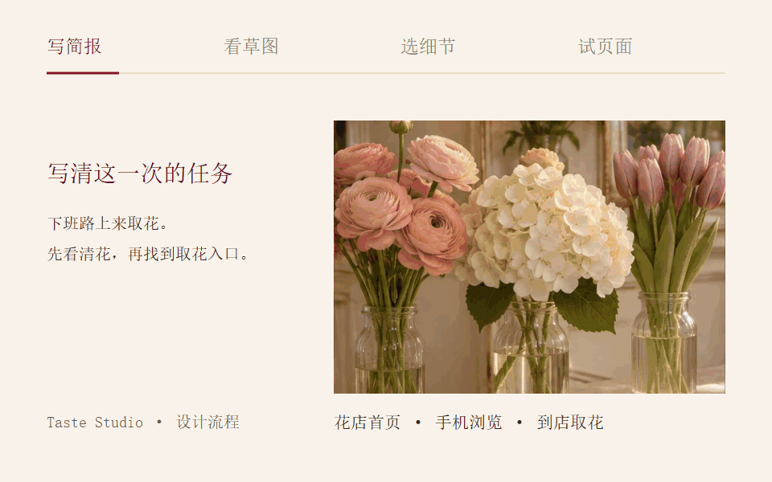
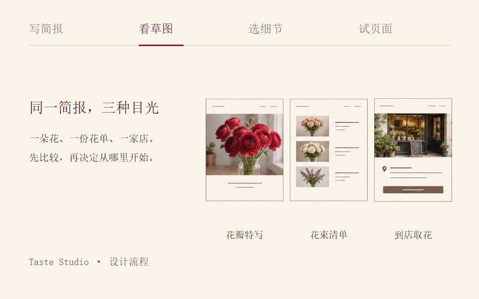
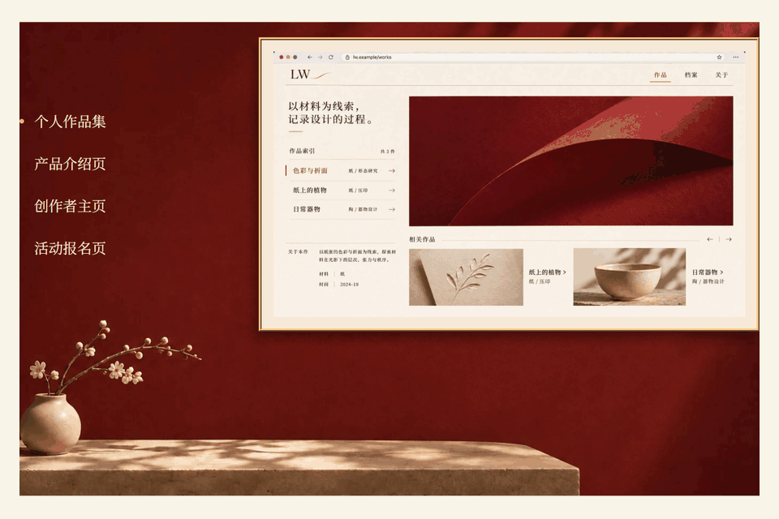
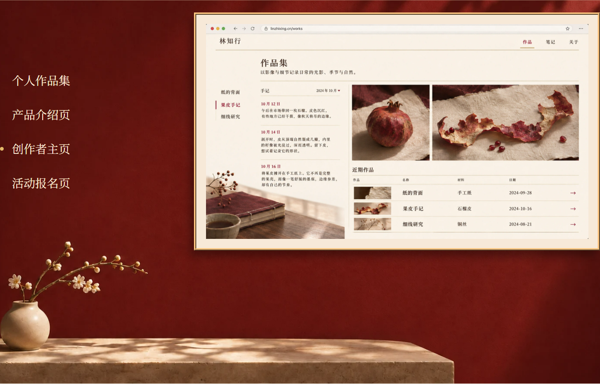

<p align="center">
  
</p>

<p align="center">
  
  
  
  
</p>

<p align="center"><a href="https://annabelle0726.github.io/taste-studio/">在线体验</a> · <a href="#一次设计怎样发生">看设计流程</a> · <a href="#四种页面各有自己的任务">看页面案例</a> · <a href="#开始使用">本地体验</a></p>

**Taste Studio 用 AI 探索更多设计的可能，让每个人的感受与选择为这些可能指明方向。**

这里包含一套设计技能，以及一个可以实际浏览、切换和操作的中文演示网站。我们想尝试的是：从一份简报出发，先看几种不同的草图，再听你说哪一处值得留下，最后检查这个细节是否还在完成的页面里。

## 一次设计怎样发生

以花店首页为例，从「下班路上来取花」的场景，一路走到页面里的取花入口。下面把项目中的图像与交互过程重新编排成四步流程示意。



1. **写简报** — 先弄清谁会打开页面、要知道什么、要完成什么动作。
2. **看草图** — 同一份内容，探索三到四种构图与视觉重心，放在一起比较。
3. **选细节** — 先听你的感受，再讨论方向。喜欢什么、想改什么，都可以从一个具体细节说起。
4. **试页面** — 把选择落实到页面，检查图片裁切、文字、按钮和反馈，也检查那个打动你的细节。

说不清原因也可以。先指出让你愿意多看一眼的地方。

<details>
<summary>查看静态流程画面</summary>



</details>

## 四种页面，各有自己的任务

同一组奶油白、酒红和暖金，进入不同的内容与使用场景。下方 GIF 展示网站中的案例选择；画框内是设计预览图。



| 页面 | 希望访客看见什么 |
| --- | --- |
| 个人作品集 | 从作品索引进入一个项目，再找到相关作品。 |
| 产品介绍页 | 通过一句话的修改，理解 Notely 的修订方式。 |
| 创作者主页 | 在手记、作品与材料之间，读到创作的过程。 |
| 活动报名页 | 把场次、余位和报名入口放在一起，方便选择。 |

<details>
<summary>查看静态案例画面</summary>



</details>

## 让偏好有具体的来处

「我想留住花瓣边缘的水珠」比一个笼统的风格标签更能指导下一稿。Taste Studio 把原话、所指的画面细节和当时的项目场景放在一起，另写一句设计解读。

这个选择先属于当前项目。以后遇到相近的任务，先展示原来的反馈，说明哪里相似，再由你确认是否继续沿用。例外和后来改变的想法也一起记录。

设计方法见 [技能说明](skills/taste-studio/SKILL.md)，项目中的实际反馈见 [设计记录](.taste-studio/feedback.md)。

## 开始使用

### 浏览演示网站

直接打开 [Taste Studio 在线网站](https://annabelle0726.github.io/taste-studio/)，无需安装。网站通过 GitHub Pages 从 `master` 分支根目录发布，推送网页更新后会自动重新发布。

网站使用原生 HTML、CSS 和 JavaScript。下载仓库后，在项目目录启动一个静态服务器：

```bash
python -m http.server 8000
```

然后打开 [本地页面](http://localhost:8000)。可以从首页进入文章，体验花店设计步骤，再切换四个页面案例。


### 使用设计技能

#### 通过 npx 安装（推荐）

先安装 [Node.js](https://nodejs.org/)（22.20 或更新版本）和 [Git](https://git-scm.com/)，在你准备做设计的项目目录中运行：

```bash
npx skills add Annabelle0726/taste-studio --skill taste-studio
```

按提示选择使用的工具和安装方式。默认安装到当前项目；如果希望多个项目都能使用，加上 `-g`：

```bash
npx skills add Annabelle0726/taste-studio --skill taste-studio -g
```

如果环境不支持符号链接，可以在安装命令后加上 `--copy`。

这里使用的是 [Skills CLI](https://github.com/vercel-labs/skills)，它直接从 GitHub 读取技能目录，不需要另行发布 npm 包。

<details>
<summary>查看技能、检查更新与卸载</summary>

```bash
# 只查看仓库中的技能，不安装
npx skills add Annabelle0726/taste-studio --list

# 查看当前项目已安装的技能；全局安装可加 -g
npx skills list

# 检查已安装技能的更新
npx skills check

# 卸载当前项目中的 Taste Studio；全局安装可加 -g
npx skills remove taste-studio
```

需要更新时，可以重新运行对应的安装命令。更多选项见 [安装工具说明](https://github.com/vercel-labs/skills/blob/main/docs/commands.md)。

</details>

#### 从本地仓库安装

已经下载本仓库时，也可以在仓库根目录运行以下命令，安装到用户范围：

```bash
npx skills add ./skills/taste-studio --skill taste-studio -g
```

#### 手动安装

也可以下载本仓库，找到 [`skills/taste-studio/`](skills/taste-studio/)，把整个文件夹复制到所用工具支持的技能目录。对于支持 `.agents/skills/` 的工具，项目内的目录应如下：

```text
你的项目/
└── .agents/
    └── skills/
        └── taste-studio/
            ├── SKILL.md
            └── scripts/
                └── draw_seeds.py
```

保留技能文件夹内的所有文件；其他工具的路径请参考其技能安装说明。安装后重新打开会话；如果工具支持刷新技能列表，也可以直接刷新。

#### 开始一次设计

在支持本地技能和图像生成的工作环境中，选择或提及 `taste-studio`，再带着具体页面开始讨论。例如：

> 用 Taste Studio 帮我设计花店首页。顾客主要在手机上浏览，想在下班前选好花、确认取花时间。请先和我写清简报，再给我三种方向比较。

技能会引导简报、草图、反馈和细化的过程。仓库中的 Python 小工具用于抽取不展示给访客的随机创意线索：

```bash
python skills/taste-studio/scripts/draw_seeds.py 3
```

安装的是设计工作方法，不会附带模型或图像生成服务。生成草图需要所在工作环境提供相应能力；不同工具中的效果仍需实际验证。Python 用于可选的创意线索脚本，没有 Python 时可以使用工作环境提供的随机来源。静态演示网站中的花店取花流程与案例预览用于说明设计方法。

## 项目结构

| 位置 | 内容 |
| --- | --- |
| [`index.html`](index.html) | 中文文章、设计步骤和案例展示。 |
| [`assets/site.css`](assets/site.css) | 配色、排版、响应式布局和动效样式。 |
| [`assets/site.js`](assets/site.js) | 页面导航、步骤切换、演示交互和图片显现。 |
| [`skills/taste-studio/`](skills/taste-studio/) | 设计技能与 Python 创意线索工具。 |
| [`assets/readme/`](assets/readme/) | 本页封面、语言标识、GIF 与可编辑素材。 |

设计方法的阅读起点是 [Anshu Chimala：How to turn your AI into a world-class designer](https://www.lennysnewsletter.com/p/how-to-turn-your-ai-into-a-world)。这个项目继续关心的是，最初打动人的东西，怎样在一次次修改之后仍然留在页面里。
